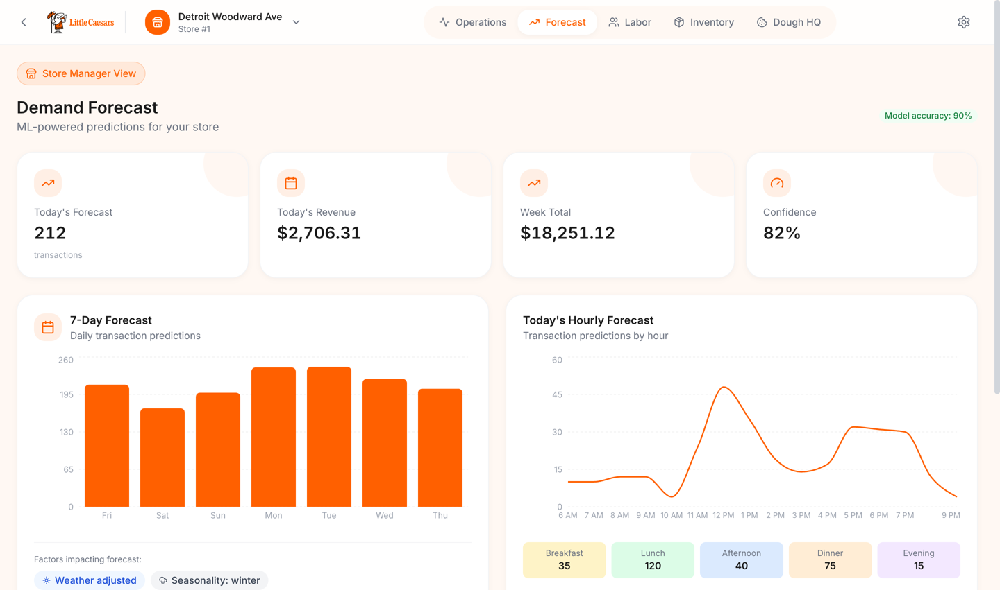
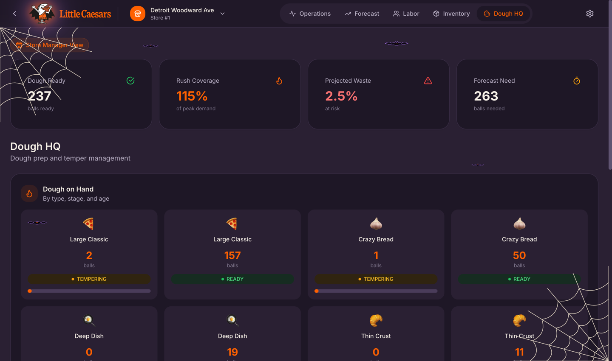
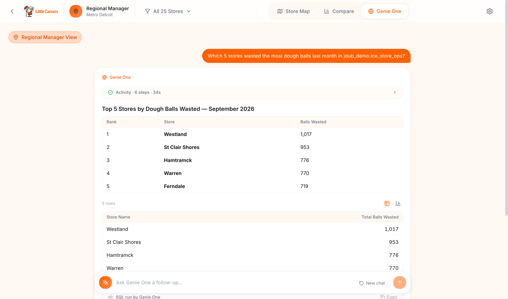
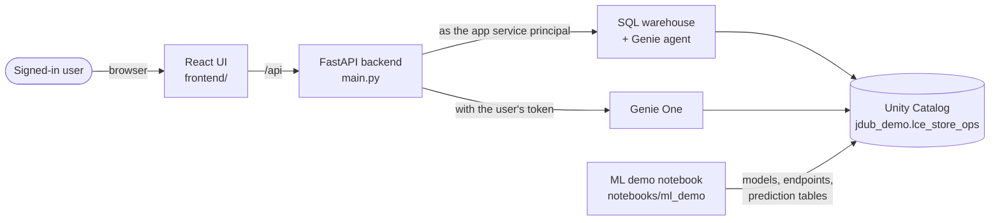

<div align="center">


# DoughSight IQ

**Store operations intelligence for Little Caesars: demand forecasts, crew plans, dough prep, and natural-language answers in one Databricks App.**

[](https://docs.databricks.com/aws/en/dev-tools/databricks-apps/)
[](https://docs.databricks.com/aws/en/genie/)
[](https://docs.databricks.com/aws/en/mlflow/)
[](https://docs.databricks.com/aws/en/machine-learning/feature-store/declarative-apis)
[](https://fastapi.tiangolo.com/)
[](https://vitejs.dev/)

</div>

<p align="center">
  
</p>

---

## ✨ What it does

| | Feature | What you get |
|---|---|---|
| 🏪 | **Store Manager view** | Operations, Forecast, Labor, Inventory, and **Dough HQ** (dough on hand by stage, temper schedule, waste and rush coverage) for one of 25 Metro Detroit stores. |
| 📍 | **Regional Manager view** | A 3D store map, store rankings with an embedded Genie agent, and a **Genie One** tab that answers questions across everything you can access in Unity Catalog. |
| 🔐 | **Genie One runs as you** | Questions go to Genie One with the signed-in user's token, so answers respect each user's Unity Catalog permissions. |
| 🧠 | **The ML behind it** | A demo notebook trains, serves, governs, and monitors the three models behind the Forecast, Labor, and Dough HQ tabs. |
| 🎃 | **Spooky mode** | A Light / Spooky slider in the settings menu flips the app to a Halloween theme, Count Little Caesars included. |

<table>
  <tr>
    <td width="50%"></td>
    <td width="50%"></td>
  </tr>
  <tr>
    <td align="center"><sub>Dough HQ in Spooky mode: dough on hand by type, stage, and age</sub></td>
    <td align="center"><sub>Genie One: "Which 5 stores wasted the most dough balls last month?"</sub></td>
  </tr>
</table>

## 🏗️ How it works



- **Two identities.** Store data and the embedded Genie agent run as the app's service principal; Genie One runs on behalf of the signed-in user (user scopes `sql`, `dashboards.genie`, `genie`).
- **Data:** synthetic Little Caesars operations in `jdub_demo.lce_store_ops`: `stores`, `pos_transactions`, `pos_line_items`, `menu_items`, `labor_schedule`, `dough_prep_log`, `inventory_levels`, `ingredients`, `employees`, `local_events`.
- **Graceful fallbacks.** Without Lakebase the app keeps state in memory (health shows `degraded`). The app still uses built-in simulated forecasts and rules; the ML notebook's models are deployed but **not wired into the app yet**.

## 🚀 Quick start

> [!NOTE]
> **Build the data and the Genie agent first.** The app reads `jdub_demo.lce_store_ops` and a Genie agent built on it. Both scripts run as SQL on a warehouse; no cluster needed.

1. **Generate the data** (25 stores, one year, about 2.5M orders):
   ```bash
   .venv/bin/python scripts/generate_lce_data.py --profile DEFAULT --warehouse 0168e23e24e6ae10
   ```
2. **Create the Genie agent** from the generated definition and note the `space_id` in the response:
   ```bash
   python3 scripts/create_genie_space.py > /tmp/doughsight_genie.json
   databricks api post /api/2.0/genie/spaces --profile DEFAULT --json @/tmp/doughsight_genie.json
   ```
3. **Create the app** once, then bind its resources and user scopes. Always send the full resources array; a partial update drops the others.
   ```bash
   databricks apps create doughsight-iq --profile DEFAULT
   databricks apps update doughsight-iq --profile DEFAULT --json '{
     "user_api_scopes": ["sql", "dashboards.genie", "genie"],
     "resources": [
       {"name": "sql_warehouse", "sql_warehouse": {"id": "0168e23e24e6ae10", "permission": "CAN_USE"}},
       {"name": "genie_space", "genie_space": {"name": "DoughSight IQ", "space_id": "<space id>", "permission": "CAN_RUN"}}
     ]}'
   ```
4. **Add your local secrets** in `config.local.env` (gitignored):
   ```bash
   echo 'TICKETMASTER_API_KEY=<your key>' > config.local.env
   ```
5. **Deploy:**
   ```bash
   zsh scripts/deploy.sh
   ```
   The script builds the UI, syncs the source, fills `{{...}}` placeholders in the workspace copy of `app.yaml` from `config.local.env`, uploads `frontend/dist`, removes Node sources (so the platform does not try a Node build), and runs `apps deploy`. Use `SKIP_BUILD=1 zsh scripts/deploy.sh` to reuse an existing build.

> [!NOTE]
> **The built UI is committed** (`frontend/dist`). After a frontend change, run `npm run build` in `frontend/` and commit `dist` with the change.

### 🧠 The ML demo notebook

`notebooks/ml_demo/doughsight_ml_demo.py` is a customer-ready walkthrough of the production ML that feeds the app. Import it into the workspace and run it on serverless (about 25 minutes on a first run, mostly endpoint startup).

| Section | What it shows |
|---|---|
| **1. Train** | **Forecast:** LightGBM on Feature Views (7d and 28d order counts, 28d average ticket) with a point-in-time check against hand-written SQL. **Labor:** a custom MLflow PyFunc that wraps an orders model with staffing rules and returns `recommended_staff`. **Dough HQ:** Ridge champion vs tuned XGBoost challenger, judged on daily waste and shortfall cost. |
| **2. Serve** | Real-time endpoints `doughsight-labor` and `doughsight-dough` (scale to zero, AI Gateway inference tables) with live calls. |
| **3. Govern** | UC model descriptions, tags, `@champion` / `@challenger` / `@previous` aliases, lineage, and example `GRANT` statements (shown, not run). |
| **4. Monitor** | Batch tables `forecast_predictions`, `labor_recommendations`, `dough_recommendations`, plus the endpoints' inference tables. |

> [!WARNING]
> **Keep the endpoint names.** The app looks for `lce-demand-forecast`, `lce-labor-optimizer`, `lce-inventory-predictor`, and `lce-dough-scheduler` and starts calling any that exist. The notebook uses `doughsight-*` names on purpose so it does not change app behavior until you wire it in.

## 🔧 Deploy to your own workspace, catalog and schema

> [!IMPORTANT]
> **Workspace-specific settings live in `app.yaml` and `scripts/deploy.sh`.** Defaults point at the reference demo (DEFAULT workspace, `jdub_demo.lce_store_ops`).

| Setting | File | What to set | Default (reference demo) |
|---|---|---|---|
| `CATALOG_NAME`, `SCHEMA_NAME` | `app.yaml` | Where the data lives | `jdub_demo`, `lce_store_ops` |
| `WORKSPACE_ID` | `app.yaml` | Org ID for the Genie embed URL | `66306676349647` |
| `TICKETMASTER_API_KEY` | `config.local.env` | Optional local-events API key | none (placeholder in `app.yaml`) |
| `PROFILE`, `APP`, `WS` | env vars for `scripts/deploy.sh` | CLI profile, app name, workspace source folder | `DEFAULT`, `doughsight-iq`, your user folder |
| `SCHEMA` | `scripts/generate_lce_data.py` | Target schema for generated data | `jdub_demo.lce_store_ops` |
| `CATALOG`, `SCHEMA` | `notebooks/ml_demo/doughsight_ml_demo.py` | Where models, features, and prediction tables go | `jdub_demo`, `lce_store_ops` |

### Privileges

| Who | Needs | Why |
|---|---|---|
| **You** (the person deploying) | `CREATE TABLE` on the schema, `CAN_MANAGE` on the app | Generate data, create the Genie agent, deploy |
| **The app's service principal** | `USE CATALOG`, `USE SCHEMA`, `SELECT` on the schema; `CAN_USE` on the warehouse; `CAN_RUN` on the Genie agent's own ACL | Store data and the embedded Genie agent |
| **Every user of the app** | `SELECT` on what they ask Genie One about | Genie One runs with each user's token |

> [!TIP]
> **Can't grant on the schema?** Send the schema owner the app's service principal client ID (`databricks apps get doughsight-iq`) and the three grants above.

## 🧪 Local development

```bash
python3 -m venv .venv && source .venv/bin/activate
pip install -r requirements.txt pytest
DATABRICKS_CONFIG_PROFILE=DEFAULT uvicorn main:app --reload --port 8000

cd frontend && npm install --legacy-peer-deps && npm run dev      # http://localhost:5173 (proxies /api to :8000)

python -m pytest tests -q
```

Local runs use your CLI profile for everything, including Genie One. Add `?theme=halloween` or `?theme=light` to any URL to force a theme.

## 📁 Project structure

```
.
├── app.yaml                 👈 app env (catalog, schema, workspace id, secret placeholders)
├── main.py                  FastAPI entry point; serves frontend/dist
├── api/                     routes: stores, operations, forecast, labor, inventory, dough, genie, genie_one, state
├── services/                data access, dough model, Genie and Genie One clients, model-serving client
├── config/                  settings and Lakebase connection
├── frontend/                React + Vite UI (src/, committed dist/)
├── notebooks/ml_demo/       train, serve, govern, monitor demo notebook
├── scripts/                 deploy.sh, generate_lce_data.py, create_genie_space.py
├── tests/                   Genie One service and API tests
└── docs/
    ├── images/              README screenshots
    └── mockups/             Halloween theme mockup
```

## 🩺 Troubleshooting

| Symptom | Fix |
|---|---|
| **Genie One: "needs user authorization for this app"** | The app needs user scopes `sql`, `dashboards.genie`, `genie` (Quick start step 3). Users reload the app and accept the new consent. |
| **`/api/health` returns `degraded`** | Lakebase is not configured; state endpoints fall back to memory. Expected for this demo. |
| **Deploy hangs or times out building** | Node files reached the workspace copy. `scripts/deploy.sh` removes them; if you deployed by hand, delete `frontend/package.json`, the lockfile, configs, and `src/` from the workspace folder. |
| **`unfilled placeholder in app.yaml`** | Add the missing key to `config.local.env`. |
| **`npm install` fails with ERESOLVE** | Use `npm install --legacy-peer-deps`. |
| **Notebook: `not an allowed value for tag policy key`** | Shared workspaces enforce tag policies; the notebook prefixes its tags with `doughsight_` and skips any a policy rejects. |
| **Notebook `%pip` fails on serverless** | Don't pin packages the runtime locks (for example `scikit-learn`); `optuna` does not build there, which is why the notebook uses a seeded random search. |

## 🗂️ About the data

All data is **synthetic**: 25 Metro Detroit stores, one year of orders, hourly labor, daily dough prep, and Tigers, Red Wings, Pistons, and Lions home games that drive dinner rushes. Little Caesars names and brand marks are used for a customer demo; keep this repo **private**.

---

<p align="center">Made with ❤️ by Jonathan Whiteley at Databricks</p>
