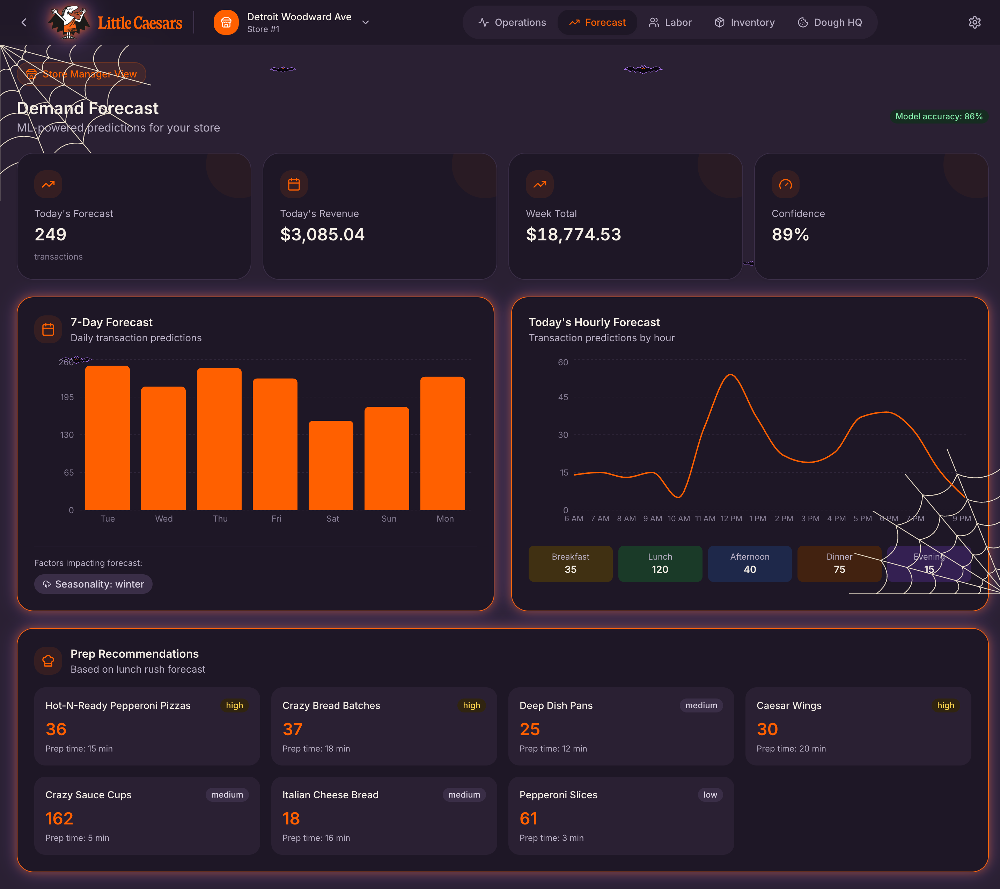

<div align="center">


# DoughSight IQ

**Store operations intelligence for Little Caesars: demand forecasts, crew plans, dough prep, and natural-language answers in one Databricks App.**

[](https://docs.databricks.com/aws/en/dev-tools/databricks-apps/)
[](https://docs.databricks.com/aws/en/genie/)
[](https://docs.databricks.com/aws/en/dev-tools/bundles/)
[](https://docs.databricks.com/aws/en/mlflow/)
[](https://docs.databricks.com/aws/en/machine-learning/feature-store/declarative-apis)
[](https://fastapi.tiangolo.com/)
[](https://vitejs.dev/)

</div>

<p align="center">
  
</p>

> [!IMPORTANT]
> **Every number in this app is synthetic.** The stores, orders, labor, dough, inventory, and staff are generated by [`scripts/generate_lce_data.py`](scripts/generate_lce_data.py). **None of it is Little Caesars (LCE) data**, and it says nothing about LCE's real sales, staffing, or operations. Little Caesars branding is used only to show what the app could look like for them.

---

## ✨ What it does

| | Feature | What you get |
|---|---|---|
| 🏪 | **Store Manager view** | Operations, Forecast, Labor, Inventory, and **Dough HQ** (dough on hand by stage, temper schedule, waste and rush coverage) for one of 25 Metro Detroit stores. |
| 📍 | **Regional Manager view** | A 3D store map, store rankings with an embedded Genie agent, and a **Genie One** tab that answers questions across everything you can access in Unity Catalog. |
| 🔐 | **Genie One runs as you** | Questions go to Genie One with the signed-in user's token, so answers respect each user's Unity Catalog permissions. |
| 🧠 | **The ML behind it** | A demo notebook trains, serves, governs, and monitors the three models behind the Forecast, Labor, and Dough HQ tabs. |
| 🎃 | **Spooky mode** | A Light / Spooky slider in the settings menu flips the app to a Halloween theme: Count Little Caesars, cobwebs, bats, and glowing ML cards. |
| 📦 | **One-command deploy anywhere** | A Declarative Automation Bundle creates the app, its Genie agent, and the grants in any workspace, pointed at your catalog and schema. |

<table>
  <tr>
    <td width="50%"></td>
    <td width="50%"></td>
  </tr>
  <tr>
    <td align="center"><sub>Dough HQ in Spooky mode: dough on hand, temper schedule, ML dough recommendations</sub></td>
    <td align="center"><sub>Genie One: "Which 5 stores wasted the most dough balls last month?"</sub></td>
  </tr>
</table>

## 🏗️ How it works


- **Two identities.** Store data and the embedded Genie agent run as the app's service principal; Genie One runs on behalf of the signed-in user (user scopes `sql`, `dashboards.genie`, `genie`).
- **Data:** synthetic, generated store operations (not LCE data) in `jdub_demo.lce_store_ops`: `stores`, `pos_transactions`, `pos_line_items`, `menu_items`, `labor_schedule`, `dough_prep_log`, `inventory_levels`, `ingredients`, `employees`, `local_events`.
- **Graceful fallbacks.** Without Lakebase the app keeps state in memory (health shows `degraded`). The app still uses built-in simulated forecasts and rules; the ML notebook's models are deployed but **not wired into the app yet**.

## 🚀 Quick start

> [!NOTE]
> **Build the data first.** The app and its Genie agent read ten synthetic tables (25 stores, one year, about 2.5M orders). One script creates them as SQL on a warehouse; no cluster needed. The Genie agent can't be created until the tables exist.

**Choose your path:**

| | Path | You need | Best for |
|---|---|---|---|
| 📦 | **Option A: Declarative Automation Bundles (DABs)** (recommended) | Databricks CLI, Python 3 | Any workspace: app, Genie agent, and grants in a few commands |
| 💻 | **Option B: `scripts/deploy.sh`** | Databricks CLI, Node 18+, Python 3 | Maintaining the reference demo app (`doughsight-iq`) |

### 📦 Option A: Declarative Automation Bundles (DABs) (recommended)

The bundle in [`databricks.yml`](databricks.yml) defines the app (source, warehouse and Genie bindings, user scopes, env), the Genie agent ([`resources/doughsight.genie_space.yml`](resources/doughsight.genie_space.yml)), and a grant job. **It reads its settings from bundle variables (`--var` or a target), not from `app.yaml`.**

**You need:** the [Databricks CLI](https://docs.databricks.com/aws/en/dev-tools/cli/install) v0.239 or later (tested on v1.18.0), logged in to the workspace, and Python 3 for the data script (standard library only):

```bash
databricks auth login --host https://<your-workspace>.cloud.databricks.com --profile mine
git clone git@github.com:jonathan-whiteley/doughsight-iq.git
cd doughsight-iq
```

No Node needed: the built UI (`frontend/dist`) is committed.

1. **Generate the data** into a catalog and schema you can write to. The script creates the schema if needed and **drops and recreates** its ten tables:
   ```bash
   python3 scripts/generate_lce_data.py --profile mine --warehouse <warehouse-id> --catalog <catalog> --schema lce_store_ops
   ```
2. **Validate.** Pick an app name nobody in the workspace uses (lowercase letters, numbers and dashes). **Not** `doughsight-iq`: see the warning below.
   ```bash
   databricks bundle validate --strict -p mine --var catalog=<catalog> --var warehouse_id=<warehouse-id> --var app_name=doughsight-<you>
   ```
3. **Deploy** the app, the Genie agent (with `CAN_RUN` for the app's service principal) and the grant job:
   ```bash
   databricks bundle deploy -p mine --var catalog=<catalog> --var warehouse_id=<warehouse-id> --var app_name=doughsight-<you>
   ```
4. **Grant the app read access** to the schema (`USE CATALOG`, `USE SCHEMA`, `SELECT`). Runs as you; if you can't grant, it prints the statements for the schema owner:
   ```bash
   databricks bundle run grant_app_access -p mine --var catalog=<catalog> --var warehouse_id=<warehouse-id> --var app_name=doughsight-<you>
   ```
5. **Start the app and deploy the code.** This is the step that applies the env and resources; it prints the app URL:
   ```bash
   databricks bundle run doughsight -p mine --var catalog=<catalog> --var warehouse_id=<warehouse-id> --var app_name=doughsight-<you>
   ```
6. **Open the URL, sign in and approve the consent prompt** (Genie One asks to act as you). Pick **Store Manager** or **Regional Manager**, then flip the **Light / Spooky** slider in the settings menu.
7. **Share it:** **Compute > Apps > your app > Permissions**, give people **Can use**.

Redeploying after a code change is just steps 3 and 5 with the **same** `--var` flags.

**Tired of repeating `--var`?** Uncomment the `mine` target at the bottom of [`databricks.yml`](databricks.yml), fill in your host and values, and run every command with `-t mine` instead of `--var ...`.

**Removing it:** `databricks bundle destroy` with the same flags deletes the app, the Genie agent, the grant job and the uploaded files. It does not drop the demo tables or revoke the grants.

**Live local events (optional):** the bundle deploys without a Ticketmaster key. To turn it on, create the secret, then uncomment the `ticketmaster` blocks in [`resources/doughsight.app.yml`](resources/doughsight.app.yml) and redeploy:
```bash
databricks secrets create-scope doughsight -p mine
printf '%s' '<consumer-key>' | databricks secrets put-secret doughsight ticketmaster_api_key -p mine
```

> [!WARNING]
> **Adopting an existing app.** The reference `doughsight-iq` app was created outside the bundle (with `scripts/deploy.sh`), so the bundle does not manage it, and `bundle deploy` with that name fails because the name is taken. To bring it under the bundle, link it first, then check the plan before deploying:
> ```bash
> databricks bundle deployment bind doughsight doughsight-iq -p DEFAULT --var app_name=doughsight-iq
> databricks bundle plan -p DEFAULT --var app_name=doughsight-iq     # must NOT show delete/recreate
> ```
> **An app's name can't change in place.** If the resolved `app_name` ever differs from the bound app, the bundle deletes and recreates it: new service principal (re-run the grant job), new URL, and the old app is gone. Only deploy when `bundle plan` shows `update`, never `delete`/`recreate`.

### 💻 Option B: `scripts/deploy.sh` (reference demo)

How the original `doughsight-iq` app on the DEFAULT workspace is deployed. Settings come from `app.yaml` and `config.local.env`, not the bundle.

1. **Generate the data** (defaults: `jdub_demo.lce_store_ops`, warehouse `0168e23e24e6ae10`):
   ```bash
   python3 scripts/generate_lce_data.py --profile DEFAULT
   ```
2. **Create the Genie agent** and note the `space_id` in the response:
   ```bash
   python3 scripts/create_genie_space.py --parent /Workspace/Users/<you> > /tmp/doughsight_genie.json
   databricks api post /api/2.0/genie/spaces --profile DEFAULT --json @/tmp/doughsight_genie.json
   ```
3. **Create the app** once, then bind its resources and user scopes. Always send the full resources array; a partial update drops the others.
   ```bash
   databricks apps create doughsight-iq --profile DEFAULT
   databricks apps update doughsight-iq --profile DEFAULT --json '{
     "user_api_scopes": ["sql", "dashboards.genie", "genie"],
     "resources": [
       {"name": "sql_warehouse", "sql_warehouse": {"id": "0168e23e24e6ae10", "permission": "CAN_USE"}},
       {"name": "genie_space", "genie_space": {"name": "DoughSight IQ", "space_id": "<space id>", "permission": "CAN_RUN"}}
     ]}'
   ```
4. **Add your local secrets** in `config.local.env` (gitignored):
   ```bash
   echo 'TICKETMASTER_API_KEY=<your key>' > config.local.env
   ```
5. **Deploy:**
   ```bash
   zsh scripts/deploy.sh
   ```
   The script builds the UI, syncs the source, fills `{{...}}` placeholders in the workspace copy of `app.yaml` from `config.local.env`, uploads `frontend/dist`, removes Node sources (so the platform does not try a Node build), and runs `apps deploy`. Use `SKIP_BUILD=1 zsh scripts/deploy.sh` to reuse an existing build.

> [!NOTE]
> **The built UI is committed** (`frontend/dist`) because both paths upload it as is and leave out `package.json` (a `package.json` in the app source makes Databricks Apps start a Node build, which times out). After a frontend change, run `npm install --legacy-peer-deps && npm run build` in `frontend/` and commit `dist` with the change.

### 🧠 The ML demo notebook

`notebooks/ml_demo/doughsight_ml_demo.py` is a customer-ready walkthrough of the production ML that feeds the app. Import it into the workspace and run it on serverless (about 25 minutes on a first run, mostly endpoint startup).

| Section | What it shows |
|---|---|
| **1. Train** | **Forecast:** LightGBM on Feature Views (7d and 28d order counts, 28d average ticket) with a point-in-time check against hand-written SQL. **Labor:** a custom MLflow PyFunc that wraps an orders model with staffing rules and returns `recommended_staff`. **Dough HQ:** Ridge champion vs tuned XGBoost challenger, judged on daily waste and shortfall cost. |
| **2. Serve** | Real-time endpoints `doughsight-labor` and `doughsight-dough` (scale to zero, AI Gateway inference tables) with live calls. |
| **3. Govern** | UC model descriptions, tags, `@champion` / `@challenger` / `@previous` aliases, lineage, and example `GRANT` statements (shown, not run). |
| **4. Monitor** | Batch tables `forecast_predictions`, `labor_recommendations`, `dough_recommendations`, plus the endpoints' inference tables. |

> [!WARNING]
> **Keep the endpoint names.** The app looks for `lce-demand-forecast`, `lce-labor-optimizer`, `lce-inventory-predictor`, and `lce-dough-scheduler` and starts calling any that exist. The notebook uses `doughsight-*` names on purpose so it does not change app behavior until you wire it in.

## 🔧 Deploy to your own workspace, catalog and schema

> [!IMPORTANT]
> **With the bundle, everything workspace-specific is a variable in [`databricks.yml`](databricks.yml).** Pass them with `--var` or set them once in a `mine` target. Defaults point at the reference demo (DEFAULT workspace, `jdub_demo.lce_store_ops`).

| Setting | File | What to set | Default (reference demo) |
|---|---|---|---|
| `catalog`, `schema` | `databricks.yml` | Where the demo tables live (the same values you gave `generate_lce_data.py`) | `jdub_demo`, `lce_store_ops` |
| `warehouse_id` | `databricks.yml` | SQL warehouse for the app, the Genie agent and the grant job | `0168e23e24e6ae10` |
| `app_name` | `databricks.yml` | A unique app name (30 characters max) | `doughsight-iq-dab` |
| `--catalog`, `--schema`, `--warehouse`, `--profile` | `scripts/generate_lce_data.py` | Where to build the data, and with which warehouse | `jdub_demo`, `lce_store_ops`, `0168e23e24e6ae10`, `DEFAULT` |
| `CATALOG`, `SCHEMA` | `notebooks/ml_demo/doughsight_ml_demo.py` | Where models, features, and prediction tables go | `jdub_demo`, `lce_store_ops` |

The Genie embed's workspace id is looked up at runtime, so a new workspace needs no `WORKSPACE_ID`. Option B's settings live in `app.yaml` (`CATALOG_NAME`, `SCHEMA_NAME`, `WORKSPACE_ID`) and the `PROFILE`, `APP`, `WS` env vars of `scripts/deploy.sh`.

**Optional customizations (not required to deploy):**
- **Genie agent instructions, sample questions and example SQL:** `scripts/create_genie_space.py`, then `python3 scripts/create_genie_space.py --bundle` to regenerate the bundle resource.
- **Dough lifecycle rules** (mix, cold hold, temper, overproof): `services/dough_model.py`.

### Privileges

| Who | Needs | Why |
|---|---|---|
| **You** (the person deploying) | `USE CATALOG` and `CREATE SCHEMA` on the catalog (or `CREATE TABLE` on an existing schema); `CAN_USE` on the warehouse; permission to create apps | Generate data, create the Genie agent, deploy |
| **The app's service principal** (created with the app) | `USE CATALOG`, `USE SCHEMA`, `SELECT` on the schema; `CAN_USE` on the warehouse; `CAN_RUN` on the Genie agent | Store data and the embedded Genie agent. The grant job does the first; the bundle does the other two |
| **Every user of the app** | `CAN_USE` on the app; `SELECT` on what they ask Genie One about | Genie One runs with each user's token |

> [!TIP]
> **Can't grant on the schema?** Run the grant job anyway: it prints the two `GRANT` statements with the app's service principal filled in. Send them to the schema owner.

## 🧪 Local development

```bash
python3 -m venv .venv && source .venv/bin/activate
pip install -r requirements.txt pytest
DATABRICKS_CONFIG_PROFILE=DEFAULT uvicorn main:app --reload --port 8000

cd frontend && npm install --legacy-peer-deps && npm run dev      # http://localhost:5173 (proxies /api to :8000)

python -m pytest tests -q
```

Local runs use your CLI profile for everything, including Genie One. Add `?theme=halloween` or `?theme=light` to any URL to force a theme.

## 📁 Project structure

```
.
├── databricks.yml           👈 bundle variables (catalog, schema, warehouse, app name) and targets
├── resources/               bundle resources: app, Genie agent (generated), grant job
├── jobs/                    grant_app_access notebook run by the grant job
├── app.yaml                 app env for scripts/deploy.sh (Option B only)
├── main.py                  FastAPI entry point; serves frontend/dist
├── api/                     routes: stores, operations, forecast, labor, inventory, dough, genie, genie_one, state
├── services/                data access, dough model, Genie and Genie One clients, model-serving client
├── config/                  settings and Lakebase connection
├── frontend/                React + Vite UI (src/, committed dist/)
├── notebooks/ml_demo/       train, serve, govern, monitor demo notebook
├── scripts/                 deploy.sh, generate_lce_data.py, create_genie_space.py
├── tests/                   Genie One service and API tests
└── docs/
    ├── images/              README screenshots
    └── mockups/             Halloween theme mockup
```

## 🩺 Troubleshooting

| Symptom | Fix |
|---|---|
| **Genie One: "needs user authorization for this app"** | The app needs user scopes `sql`, `dashboards.genie`, `genie` (the bundle sets them; Option B step 3). Users reload the app and accept the new consent. |
| **`bundle deploy` fails creating the Genie space (table not found)** | The demo tables don't exist in that catalog and schema yet. Run `scripts/generate_lce_data.py` with the same `--catalog` / `--schema` (Quick start step 1). |
| **`bundle deploy`: app name already exists** | Pick another `app_name`, or bind the existing app first (see **Adopting an existing app**). |
| **App shows "App Not Available" right after `bundle deploy`** | `bundle deploy` creates the app but doesn't start the code. Run `databricks bundle run doughsight` (step 5). |
| **Store pages show demo numbers or "permission denied"** | The app's service principal can't read the schema. Run `databricks bundle run grant_app_access`, or send its printed `GRANT` statements to the schema owner. |
| **App crashes at boot: "SQLAlchemy asyncio module requires ... greenlet"** | Fresh app environments don't pull `greenlet` in on their own; `requirements.txt` pins `sqlalchemy[asyncio]` for this. Keep it if you edit requirements. |
| **`/api/health` returns `degraded`** | Lakebase is not configured; state endpoints fall back to memory. Expected for this demo. |
| **Deploy hangs or times out building** | Node files reached the workspace copy. `scripts/deploy.sh` removes them; if you deployed by hand, delete `frontend/package.json`, the lockfile, configs, and `src/` from the workspace folder. |
| **`unfilled placeholder in app.yaml`** | Add the missing key to `config.local.env`. |
| **`npm install` fails with ERESOLVE** | Use `npm install --legacy-peer-deps`. |
| **Notebook: `not an allowed value for tag policy key`** | Shared workspaces enforce tag policies; the notebook prefixes its tags with `doughsight_` and skips any a policy rejects. |
| **Notebook `%pip` fails on serverless** | Don't pin packages the runtime locks (for example `scikit-learn`); `optuna` does not build there, which is why the notebook uses a seeded random search. |

## 🗂️ About the data

> [!IMPORTANT]
> **This is synthetic, generated data. It is not actual Little Caesars (LCE) data.** No LCE systems, extracts, or customer data were used to build it.

- **How it's made:** [`scripts/generate_lce_data.py`](scripts/generate_lce_data.py) builds every table with SQL on a warehouse from deterministic hash-based pseudo-random values, so each run produces the same dataset.
- **What's in it:** 25 made-up Metro Detroit stores (invented managers, `555` phone numbers, approximate map points), one year of orders ending 2026-10-01, hourly labor, daily dough prep, inventory, and a synthetic schedule of Tigers, Red Wings, Pistons, and Lions home games that drives dinner rushes.
- **What's planted:** demand patterns (lunch and dinner rushes, game-night spikes), dough waste from over-mixing, and stockouts on event nights, so the forecasts, Dough HQ, and Genie answers have something to find.
- **Menu and branding:** menu item names, prices, and the Little Caesars marks are public-facing brand references used for a demo look and feel; prices, costs, and volumes are illustrative, not LCE figures.

Keep this repo **private**: it uses Little Caesars branding for a customer demo.
---

<p align="center">Made with ❤️ by Jonathan Whiteley at Databricks</p>
